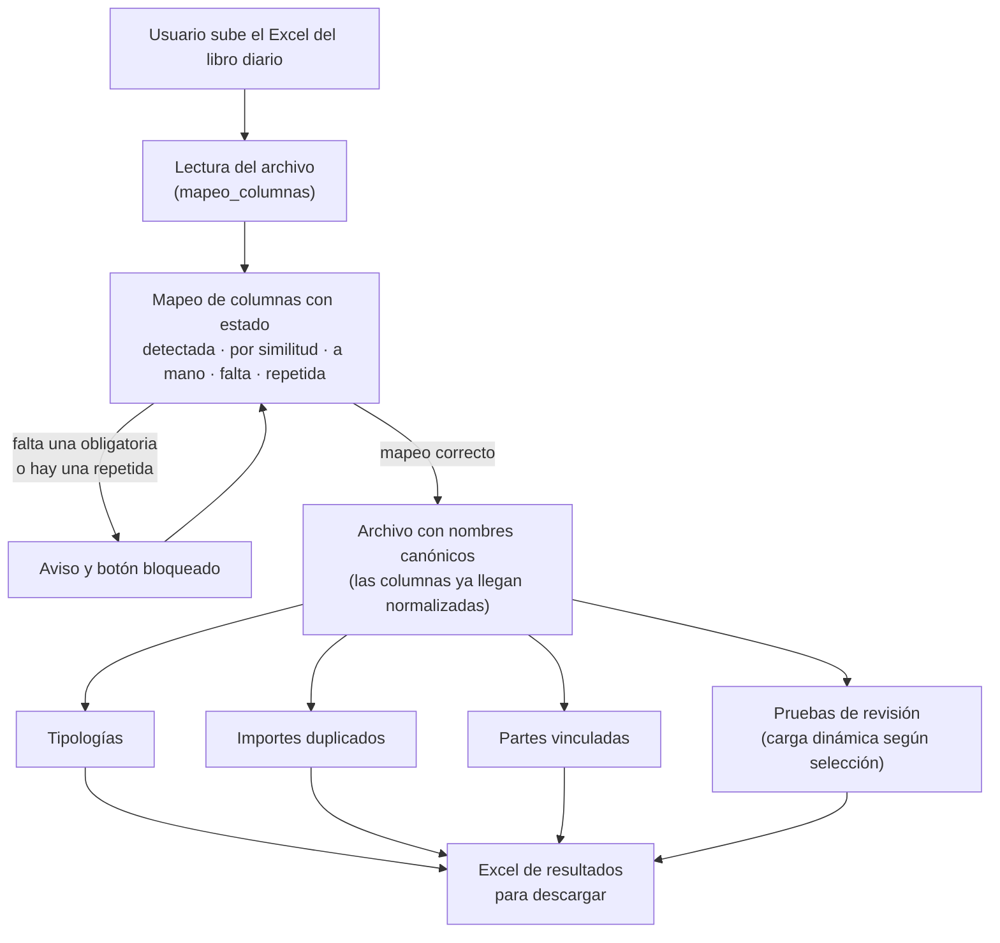
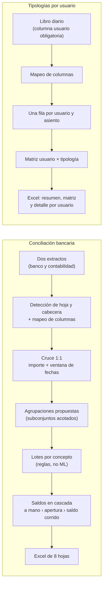

# Arquitectura de AUDITPRO

Cómo está organizada la herramienta y cómo llega a los usuarios. El código es privado; este
documento explica el diseño con tres diagramas. Las decisiones técnicas detrás de cada pieza
están en [TECNICAS.md](TECNICAS.md).

## 1. Flujo de un análisis

Lo que ocurre desde que el usuario sube su libro diario en Excel hasta que descarga el
resultado. El diagrama muestra que **todo análisis pasa por el mismo punto de entrada**, el
mapeo de columnas, y que este puede detener la ejecución.

## 2. Páginas independientes

La conciliación bancaria y las tipologías por usuario son páginas propias del menú lateral.
Tienen su propio flujo de subida y mapeo para **no poner en riesgo los análisis ya en uso**
cada vez que se añade una funcionalidad nueva.

## 3. Cómo llega la herramienta a las oficinas

La aplicación se ejecuta en el equipo de cada usuario, sin servidor. Para poder añadir
mejoras sin que nadie instale nada, el reparto funciona así. El diagrama muestra que una
versión **no llega a la oficina hasta que yo la doy por probada**.

Qué consigue este diseño:

* **Los datos no salen de cada equipo.** No hay servidor central que procese los Excel.
* **Los usuarios no hacen nada distinto.** Siguen abriendo la aplicación con doble clic.
* **Un error no llega a todos a la vez.** Lo que se prueba y lo que usa la oficina son
ramas separadas.
* **Funciona en equipos sin Python ni Git**, porque el paquete de instalación los incluye de
forma portátil.

