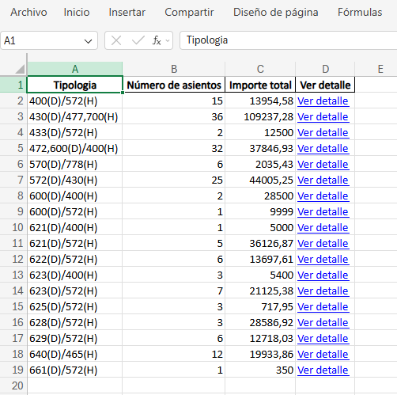
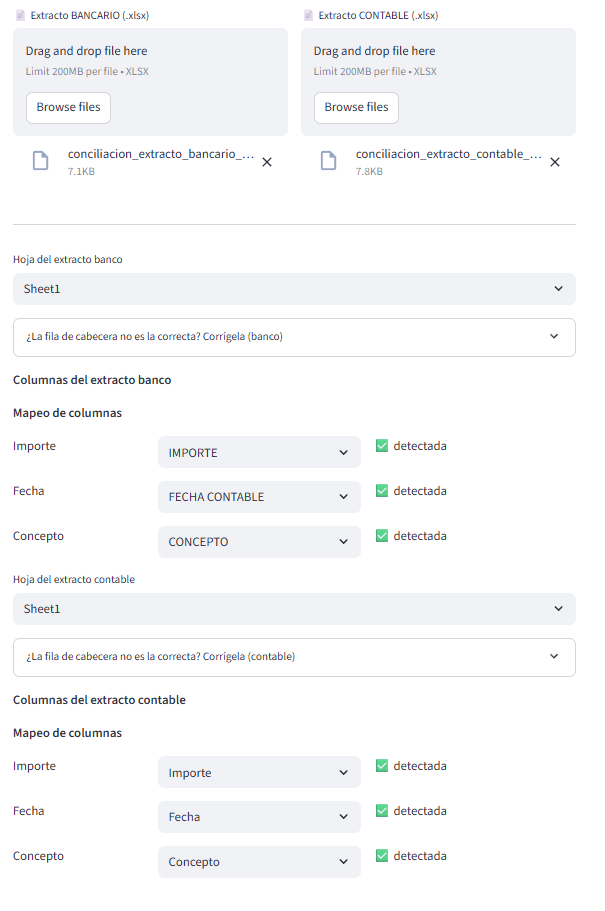
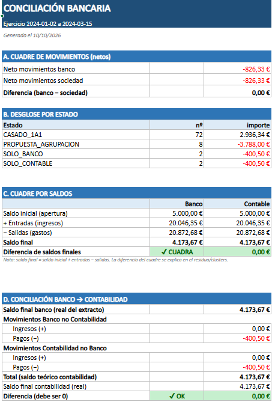

# 📈 AUDITPRO — Análisis forense de asientos contables

> Herramienta que analiza el libro diario de una empresa en Excel, señala los asientos que
> merece la pena revisar y concilia el banco contra la contabilidad. La diseñé y la mantengo
> yo; la usan **8 profesionales en las oficinas de España** de una firma de auditoría.

## 🎬 Vídeo demostración


https://github.com/user-attachments/assets/b9fabf15-d3a1-4b3e-81ab-cb56bed43337


<!-- PENDIENTE: arrastrar aquí el MP4 desde el editor web de GitHub; pegará una URL user-attachments y se verá el reproductor -->

**English summary** — AUDITPRO is a Python/Streamlit tool I built during my internships at an
audit firm (Kreston Iberaudit, Spain). It reads general-ledger Excel files, flags journal
entries worth reviewing (Benford's law, round amounts, gaps in numbering, entries posted on
weekends and holidays, duplicates, related-party entries…) and reconciles bank statements against the books. It runs entirely
on the user's machine, so client data never leaves the laptop. It is currently used by 8
auditors across the firm's offices. The source code is private; this repository documents
what it does and the technical decisions behind it. Code walkthrough available on request.

---

## 🎯 El problema

En auditoría, revisar miles de asientos del libro diario y conciliar el banco con la
contabilidad son tareas repetitivas, largas y propensas a errores cuando se hacen a mano en
Excel. Cada ERP exporta además las columnas con nombres distintos, así que ni siquiera la
parte mecánica se reutiliza de un cliente a otro.

Durante mis prácticas de verano de 2025 vi que gran parte de ese trabajo se podía
automatizar y empecé a construir la herramienta. Desde entonces la he ido ampliando con los
módulos que se necesitaban y hoy la mantengo yo.

## ✨ Qué hace

Se sube el Excel con el libro diario, se elige qué análisis ejecutar y se descarga el
resultado en otro Excel. La tabla resume las funciones; cada fila indica qué problema
resuelve para el auditor.

|Función|Qué hace|Para qué le sirve al auditor|
|-|-|-|
|**Tipologías**|Agrupa los asientos por su estructura de cuentas Debe/Haber (por ejemplo `430,472(D)/770(H)`).|Ver de un vistazo qué tipos de asiento hay y detectar los que no encajan.|
|**Importes duplicados**|Encuentra asientos de gasto o ingreso con la misma estructura y el mismo importe.|Localizar posibles facturas duplicadas o errores de imputación repetidos.|
|**Partes vinculadas**|Cruza los asientos con las cuentas del PGC asociadas a empresas del grupo, socios y administradores.|Revisar de forma sistemática las operaciones vinculadas.|
|**Pruebas de revisión**|Seis pruebas: Ley de Benford, asientos faltantes, fechas inusuales (fines de semana y festivos), importes acabados en 999, múltiplos de 1.000 e importes superiores a materialidad.|Señalar asientos sospechosos con pruebas de auditoría forense reconocidas.|
|**Conciliación bancaria**|Cruza el extracto del banco con el de la contabilidad por importe y fecha, propone agrupaciones y calcula el cuadre de saldos.|Saber qué coincide, qué no y cuánto queda sin explicar.|
|**Tipologías por usuario**|Mismo análisis de tipologías, pero por quién registra cada asiento.|Revisar la segregación de funciones.|

### Pensada para usuarios que no son técnicos

* **Mapeo de columnas con estado.** Al subir el archivo, la herramienta reconoce las columnas
(más de 50 alias conocidos) y muestra el estado de cada dato: ✅ detectada, ⚠️ por
similitud, ❌ falta o repetida. El usuario puede asignarla a mano, y si falta una
obligatoria no deja ejecutar. Así nunca se analiza con una columna equivocada sin que
nadie se entere.
* **Explicaciones en pantalla.** Cada opción indica qué columnas necesita, y la conciliación
explica qué contiene cada hoja del Excel de resultados.
* **Resultado en Excel**, que es el formato en el que trabaja el auditor.

## 🖼️ Capturas

Todas con datos ficticios.

|||
|-|-|
|||
|**Tipologías:** hoja Resumen del Excel descargado, con enlaces al detalle.|**Conciliación:** los dos extractos cargados y el mapeo de cada uno.|
|||
|**Resultado de la conciliación:** lo cuadrado, lo pendiente y los saldos.||

<!-- PENDIENTE: falta img/05_conciliacion_resumen.png (con datos de ejemplo) -->


## 🔒 Privacidad por diseño

Los Excel contienen datos contables reales de clientes. Por eso la aplicación **no tiene
servidor ni base de datos**: se ejecuta en el ordenador de cada usuario, los archivos se
procesan allí y no salen de él.

## 🚀 Cómo se reparte y se mantiene

La herramienta funciona en los equipos de varias oficinas sin que los usuarios instalen nada:

* Un paquete portátil incluye Python y Git, así que no hace falta tener nada instalado.
* Al abrirla con doble clic, el lanzador descarga la última versión aprobada, instala las
dependencias y arranca la aplicación.
* Hay dos ramas: una para probar los cambios y otra con la versión que usa la oficina. Una
versión solo pasa a la oficina cuando yo la doy por probada.
* Las versiones y sus cambios están en el [CHANGELOG](CHANGELOG.md).

Más detalle en [ARQUITECTURA.md](ARQUITECTURA.md).

## 🧠 Decisiones de diseño que importan

* **Reglas explicables antes que modelos opacos.** En auditoría hay que poder justificar por
qué dos movimientos se consideraron relacionados. Por eso la herramienta usa reglas
deterministas y no machine learning, aunque a veces habría sido la opción más vistosa.
* **Suficientemente bueno y simple antes que óptimo y complejo**, cuando el volumen real lo
permite y el resultado debe poder explicarse a un auditor sin perfil técnico.
* **Fallar de forma visible.** El mapeo con estado, los avisos y el bloqueo existen para que
un error de datos se vea antes de producir un informe.

El razonamiento completo, con ejemplos de código, está en [**TECNICAS.md**](TECNICAS.md).

## 🛠️ Tecnologías

Python 3.11 · Streamlit · pandas · NumPy · OpenPyXL · XlsxWriter · pytest · Git y GitHub

## 📂 Estructura del proyecto

```
auditpro/
├── app.py                          # Interfaz principal (Streamlit)
├── bienvenida.py                   # Pantalla de bienvenida
├── mapeo_columnas.py               # Reconocimiento y estado de las columnas del Excel
├── requisitos.py                   # Columnas que necesita cada análisis
├── validador_contable.py           # Validaciones de integridad (cuadre, secuencia, duplicados)
├── criterios/                      # Pruebas de revisión y detección de anomalías
│   ├── Ley_Benford.py
│   ├── asientos_faltantes.py
│   ├── fechas_inusuales.py
│   ├── importes_acabados_999.py
│   ├── multiplos_1000.py
│   ├── superiores_materialidad.py
│   ├── importes_duplicados.py
│   └── partes_vinculadas.py
├── conciliacion/
│   └── conciliacion_bancaria.py    # Motor de conciliación banco ↔ contabilidad
├── tipologias/
│   ├── detalle_tipologias.py       # Tipologías por asiento
│   └── tipologias_por_usuario.py   # Tipologías por usuario
├── pages/                          # Páginas del menú lateral
│   ├── 1_🏦_Conciliacion_Bancaria.py
│   └── 2_👤_Tipologias_por_Usuario.py
├── datos_ejemplo/                  # Excel ficticios para demostración
└── tests/                          # Pruebas automáticas (pytest)
```

## 👤 Mi papel

Soy el único desarrollador. He hecho:

* El diseño y desarrollo completo de la herramienta, a partir de un problema real del equipo.
* Los motores de análisis, la conciliación bancaria y la interfaz.
* El sistema de reparto y actualización a las oficinas, y el mantenimiento posterior.
* La recogida de problemas reales de los usuarios (por ejemplo, un extracto con cabeceras
repetidas que rompía la conciliación, que está explicado en [TECNICAS.md](TECNICAS.md)).

## 🔭 Qué falta

Soy consciente de los límites actuales, y la hoja de ruta sale de ellos:

* Separar la lectura, la transformación y la escritura de cada módulo para poder probarlos
sin Excel y reutilizar el motor fuera de Streamlit.
* Declarar el esquema de datos en un solo sitio, con mensajes claros cuando falta una columna.
* Ampliar las pruebas automáticas (hoy la cobertura es mínima).
* Mejorar la observabilidad (registros) y limitar el tamaño de los archivos subidos.

## 📬 Contacto

* LinkedIn: [Leonardo Fernández Umbría](https://www.linkedin.com/in/leonardo-fernandez-umbria/)
* GitHub: [@Leofu2005](https://github.com/Leofu2005)

El código fuente es privado; puedo enseñarlo y explicarlo en una conversación.

---

© 2026 Leonardo Fernández Umbría. Todos los derechos reservados.

